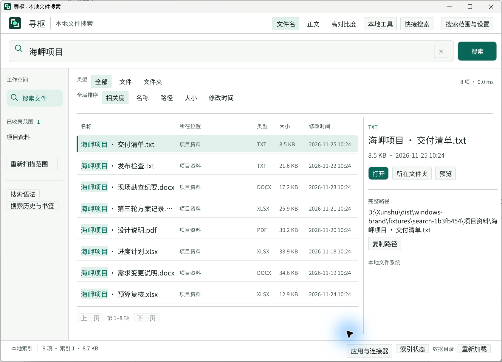
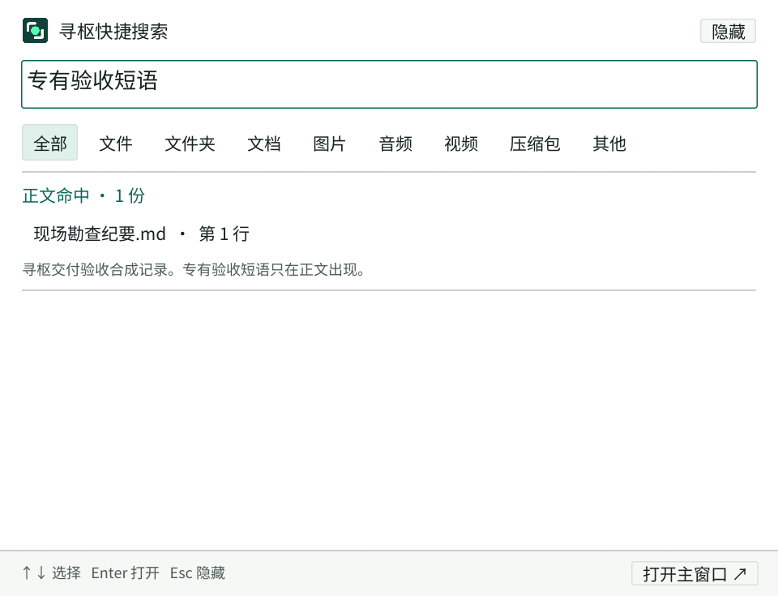

# 寻枢 Xunshu

**面向中文资料的本地文件搜索工作台。** 按文件名、拼音和属性定位文件，也能从同一个搜索框查找文档里的句子、表格单元格和扫描页。

寻枢适合经常查找项目资料、办公文档和离线归档的用户。通过原生桌面界面配置收录范围，也可用命令行执行搜索、索引和诊断。索引、查询和可选模型推理都在本机运行，无需云端搜索服务。

[下载测试候选版](https://github.com/linsky-dev/Xunshu/releases) · [查询语法](rust/crates/xs-query/README.md) · [平台验收](rust/VALIDATION.md) · [从源码构建](#从源码构建)





## 寻枢能做什么

| 使用场景 | 对应能力 |
| --- | --- |
| 记得资料叫什么 | 支持全拼、简拼、混拼和多音字。可以叠加名称、路径、扩展名、大小、修改时间条件，也支持布尔组合和正则。 |
| 只记得文档里写了什么 | 直接在主窗口或快捷窗输入关键词，可查找 Office、OpenDocument、PDF 文字层及常见文本文件。结果可定位到段落、页码、幻灯片或工作表单元格，具体取决于文件类型。 |
| 查扫描件或按意思找资料 | 可分别启用本地 OCR 和语义检索。两者需要随测试包提供或单独准备的模型资源。扫描 PDF 的支持范围见正文索引说明。 |
| 资料已归档到移动硬盘 | 导入 EFU 文件清单。磁盘离线时仍可查找清单中的文件名、路径与属性。 |
| 在文件与搜索之间频繁切换 | 窗口支持打开、定位、复制路径及受支持格式的快速预览。Windows 安装版可从桌面启动，最小化到通知区域后可快速恢复。 |

[正文格式、模型与限制](rust/crates/xs-content/README.md) · [平台构建和资源说明](rust/docs/PLATFORM_BUILD.md)

## 与同类软件的差异

以下对照以各项目公开说明为依据，关注各自适用的工作流，未进行同机性能排名。

| 软件 | 擅长的场景 | 寻枢的差异与优势 |
| --- | --- | --- |
| **Everything** | Windows 上快速建立 NTFS 文件名索引，提供丰富的查询语法，也可用 `content:` 查找文件内文字。 [官方文档](https://www.voidtools.com/en-us/support/everything/searching/) · [官方常见问题](https://www.voidtools.com/en-uk/faq/) | 寻枢为选定目录单独建立正文索引。反复查阅项目资料时，可在索引上检索并定位页码或表格单元格，也可按需启用离线 OCR。 |
| **Listary** | 擅长键盘快速启动、文件对话框目录切换，以及深入的文件筛选。 [官方文档](https://help.listary.com/) · [文件搜索](https://help.listary.com/search-file) | 寻枢的重点是本地资料检索。用户可以独立控制文件名与正文的收录范围，在搜索工作台核对文件详情，并继续查找已离线的 EFU 归档清单。 |
| **FSearch** | 在类 Unix 系统上按名称、路径和属性快速定位文件，支持正则及索引排除规则。 [项目主页](https://github.com/cboxdoerfer/fsearch) | 寻枢把中文全拼、简拼、混拼和多音字纳入文件名查询，并在同一桌面程序中提供可选正文索引、OCR 和语义检索。 |

## 设计与技术创新

- **一个入口，两层索引。** 文件名与正文独立收录，主窗口与快捷窗共用搜索框、分类和最近打开记录。正文默认跟随文件范围，OCR 与语义检索按需启用。
- **中文查询贯穿桌面与命令行。** 两个入口共用 Rust 查询引擎。拼音匹配支持多音字，还可与文件属性条件组合，减少人工改名或补标签的成本。
- **索引更新可恢复。** 实时收录能合并重复变更，已知文件的变更可局部更新，遇到目录级变化可重新校准。正文索引在写入后切换。后台校准可发布成功收录的文档并标明部分覆盖，手工重建失败或取消时保留上一版快照。
- **从命中结果直接回到资料。** 文件名工作台把文件信息和操作放在选中项旁边。正文命中提供文档内定位，减少打开多个相似文件逐个比对的时间。

## 快速上手

1. 安装后打开寻枢，进入「搜索范围与设置」，添加需要检索的本地目录并执行扫描。
2. 在「文件名」输入关键词。比如搜索「项目」，先看「全部」，再选「文档」「图片」「音频」「视频」「压缩包」或「其他」。分类按扩展名判断，可与关键词、搜索语法和排序一起使用。「其他」包括未归入前述类别的文件和无扩展名文件。
3. 在主窗口或快捷窗输入关键词。文件名结果先返回，已收录的正文会在同一界面显示命中片段与页码等位置。两处都支持文档、图片等类型筛选。
4. 首次配置可选择「使用全部固定本地磁盘」。确认范围后，寻枢默认在后台收录支持格式的正文。快捷窗在空闲时显示最近通过寻枢打开的收录文件，可用方向键、回车或 `Ctrl+1` 至 `Ctrl+4` 打开。

「正文收录」设置可调整范围、关闭正文或启用 OCR 与语义检索。升级保留现有正文设置。首次全范围正文发布需要时间，权限受限、排除、损坏、文件过大或格式不支持会影响覆盖；文件名和正文各有自己的索引覆盖。

| 查询示例 | 结果 |
| --- | --- |
| `ext:pdf 合同` | 查找文件名包含「合同」的 PDF。 |
| `pinyin:xssj` | 按简拼查找「寻枢设计」等名称。 |
| `path:项目 size:>1MB` | 查找路径包含「项目」且大于 1 MB 的文件。 |

「全部」覆盖当前索引的收录范围。找不到文件时，可在「索引状态」检查收录范围、扩展名规则和覆盖状态。压缩包本身可以按名称或类别检索，包内成员需要解压到收录目录后才能被文件名索引发现。

侧栏的「已配置范围」表示授权扫描的位置，底部状态栏显示当前快照的收录数量和覆盖状态。如果整盘扫描受权限阻碍，可以先把桌面或文档目录单独加入范围，再从「补扫单个目录」刷新它。命令行也可用 `xunshu scan --root <已配置目录>` 执行同一操作。补扫沿用该目录已有的收录规则，并保留其他目录的索引。

## 当前版本与验证状态

当前版本为 **`0.18.0-alpha.7`（Alpha8 内部测试候选，2026 年 11 月 26 日）**。Windows 11 已验证文件类别切换、指定目录补扫、托盘恢复和配置保留。统信 UOS 兼容性测试包以 **UOS Desktop 20 1070 amd64 / GLIBC 2.28** 为目标，已通过 Debian 安装与桌面测试。当前 UOS 1070 虚拟机执行候选程序时退出码为 139，UOS 原生安装、DDE 和 Windows 10 的验收待完成。测试候选包未签名。

[当前验证记录](rust/VALIDATION.md) · [双平台验收路径](rust/docs/PLATFORM_ACCEPTANCE.md) · [历史 alpha.7 验收数据](checkpoints/alpha7/QA_Evidence.json)

## 从源码构建

项目使用 Rust 1.99.1。首次准备工具链和锁定依赖时需要联网，依赖准备完成后可离线构建。

```sh
cd rust
cargo fetch --locked
cargo build --locked --offline --release --workspace
```

桌面入口 `xs-ui` 和命令行入口 `xunshu` 位于 `rust/target/release/`。Windows 的可执行文件带 `.exe` 后缀。使用 `xunshu --help` 查看命令。正文工作进程、字体和本地模型资源的部署方法见构建与恢复文档。

[平台构建说明](rust/docs/PLATFORM_BUILD.md) · [离线资源与恢复](rust/docs/RECOVERY.md)

## 许可证

Rust 源码采用 MIT 许可证。 [MIT 许可证](rust/LICENSE) · [第三方许可声明](rust/THIRD_PARTY.md)
